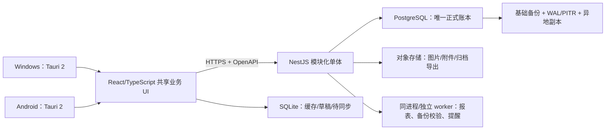

# 农机个体商户 ERP 技术架构调研与选型建议

> 状态：技术预研，供项目立项决策使用
> 调研日期 / 资料访问日期：2026-08-12
> 适用范围：商品、农机整机与配件、采购、销售、库存、现金/银行流水、客户欠款（应收）、供应商欠款（应付）、打印与扫码；Windows 桌面端 + Android 手机端优先
> 证据边界：本文只引用框架官网、官方文档、标准组织或政府部门发布的一手资料。产品是否满足真实门店环境，仍须经过打印机、扫码枪、手机、网络和数据恢复的实机验收。

## 1. 结论摘要

### 1.1 推荐方向

**推荐采用“云端主账 + 受控离线草稿 + 模块化单体”的架构。**

- 客户端：**Tauri 2 + React + TypeScript + Vite**，共用一套响应式业务界面，打包 Windows 桌面应用和 Android 应用。
- UI：**Tailwind CSS + shadcn/ui 风格的自有设计系统**，桌面侧强调高密度表格和键盘效率，手机侧强调单手操作、扫码和大触控目标；以 WCAG 2.2 AA 作为可访问性目标。
- 服务端：**Node.js 24 LTS + NestJS 模块化单体**，REST/OpenAPI 契约；不在第一版引入微服务、Kafka、Kubernetes 或多种数据库。
- 主数据库：**PostgreSQL 18 的最新安全修订版**；所有正式库存、应收、应付和资金变更只由服务端事务提交。
- 本地数据库：**SQLite 只用于缓存、离线草稿和待同步队列**，不得成为财务主账，也不得让客户端直接连接 PostgreSQL。
- 部署：默认选择中国境内云主机/托管 PostgreSQL/对象存储；如果门店网络实测明显不稳定，可不改业务代码地切换为“门店局域网服务器为主、云端做异地备份/远程入口”。
- 第一阶段财务定位：先做**经营管理子账**（收付款、应收应付、毛利、库存成本、对账），并向会计/代账人员导出；若要替代法定会计软件，则必须另立“合规会计”阶段，逐条满足财政部会计软件与电子凭证/档案要求。

### 1.2 为什么不是“全离线自动同步”

**事实：** PowerSync 官方说明其机制是让客户端直接读写本地 SQLite 并与后端数据库同步，但截至访问日，其 Capacitor SDK 标为 beta、Tauri SDK 标为 alpha；Electric 官方则明确定位为 PostgreSQL 的“读取路径同步引擎”，写入需要通过应用 API 处理。[PowerSync 概览](https://docs.powersync.com/intro/powersync-overview)；[Electric Sync 概览](https://electric.ax/docs/sync/)

**推论：** 对库存扣减、收款核销和欠款余额而言，多个离线设备同时写入后再自动合并，会引入重复单据、超卖、核销冲突和难以审计的纠错成本；在目标规模下，这些成本大于“断网时不能正式过账”的影响。

**推荐：** 断网时允许查缓存、扫码、建客户、开销售/采购/盘点草稿；恢复联网后由服务端重新校验价格、库存、客户信用、单号和幂等键，再一次性过账。收款、退款、应收应付核销、反结账等高风险动作必须在线。

## 2. 已核实的技术事实

以下内容是资料能够直接支持的**事实**，不是对本项目的最终选择。

### 2.1 跨端外壳

- Tauri 官方将其定义为可面向主流桌面和移动平台构建应用的框架，可配合任何可编译为 HTML/CSS/JavaScript 的前端；它使用系统 WebView，因此不需要在每个应用中捆绑浏览器引擎。[Tauri：What is Tauri?](https://v2.tauri.app/start/)
- Tauri 官方 SQL 插件支持 Windows、Linux、macOS、Android、iOS，以及 SQLite、MySQL、PostgreSQL 驱动，并支持数据库迁移。[Tauri SQL 插件](https://v2.tauri.app/plugin/sql/)
- Tauri 官方条码插件面向移动端摄像头，支持二维码、EAN-13 等条码；危险能力默认阻止，必须显式授权。[Tauri Barcode Scanner](https://v2.tauri.app/plugin/barcode-scanner/)
- Tauri 官方 Stronghold 插件可在上述五类平台存储密钥和秘密；Updater 插件要求使用签名验证更新，且签名校验不能关闭。[Tauri Stronghold](https://v2.tauri.app/plugin/stronghold/)；[Tauri Updater](https://v2.tauri.app/plugin/updater/)
- Capacitor 官方将其定义为 Web 应用的跨平台原生运行时，主要覆盖 iOS、Android，并允许通过插件访问 Swift/Java 原生能力。[Capacitor 官方文档](https://capacitorjs.com/docs)
- Electron 官方通过内嵌 Chromium 和 Node.js，使一套 JavaScript 代码面向 Windows、macOS、Linux；其主进程/渲染进程模型、系统打印 API和自动更新能力都有官方文档。[Electron 简介](https://www.electronjs.org/docs/latest/)；[Electron 进程模型](https://www.electronjs.org/docs/latest/tutorial/process-model)；[Electron webContents 打印](https://www.electronjs.org/docs/latest/api/web-contents/)；[Electron 更新](https://www.electronjs.org/docs/latest/tutorial/updates)
- PWA 可以安装，并通过 Service Worker 缓存资源、提供离线入口；离线业务数据仍需 IndexedDB 等持久存储机制。[web.dev PWA 概览](https://web.dev/learn/pwa/welcome)；[web.dev Service Workers](https://web.dev/learn/pwa/service-workers)

### 2.2 服务端、契约与测试

- Node.js 官方要求生产应用只使用 Active LTS 或 Maintenance LTS；访问日 Node.js 24 为 LTS，26 为 Current。[Node.js Releases](https://nodejs.org/en/about/previous-releases)
- NestJS 官方定位为构建高效、可扩展 Node.js 服务端应用的框架，并提供请求验证、认证、授权/RBAC 和 OpenAPI 文档模块。[NestJS 简介](https://docs.nestjs.com/introduction)；[Validation](https://docs.nestjs.com/techniques/validation)；[Authentication](https://docs.nestjs.com/security/authentication)；[Authorization](https://docs.nestjs.com/security/authorization)；[OpenAPI](https://docs.nestjs.com/openapi/introduction)
- Playwright 官方提供跨 Chromium、WebKit、Firefox 的端到端测试，以及移动浏览器模拟、CI、追踪和报告能力。[Playwright 安装与能力](https://playwright.dev/docs/intro)
- Vitest 官方说明其由 Vite 驱动，支持测试、覆盖率、浏览器模式、类型测试等能力。[Vitest 指南](https://vitest.dev/guide/)

### 2.3 数据库、备份与权限

- PostgreSQL 18 官方支持事务、约束、权限系统和行级安全策略；启用行级安全但没有策略时，普通访问采用默认拒绝。[PostgreSQL 18 行级安全](https://www.postgresql.org/docs/18/ddl-rowsecurity.html)
- PostgreSQL 的 WAL 连续归档配合基础备份可做时间点恢复（PITR），但不会自动备份 `postgresql.conf`、`pg_hba.conf` 等手工配置文件。[PostgreSQL 连续归档与 PITR](https://www.postgresql.org/docs/current/continuous-archiving.html)
- SQLite 官方建议其适合设备本地存储和应用文件格式；对于许多客户端经网络同时访问同一数据库，官方建议使用客户端/服务器型数据库。WAL 模式允许读写并发，但仍只有一个写入者，且相关进程需位于同一主机。[SQLite 适用场景](https://www.sqlite.org/whentouse.html)；[SQLite WAL](https://www.sqlite.org/wal.html)

### 2.4 UI 与可访问性

- shadcn/ui 官方将其描述为“开放代码”的可访问组件和代码分发方式，组件顶层源码归项目自己维护，而不是一个黑盒组件包。[shadcn/ui Introduction](https://ui.shadcn.com/docs)
- Tailwind CSS 官方当前文档提供 Vite 集成、响应式设计、主题变量、深色模式等能力。[Tailwind CSS with Vite](https://tailwindcss.com/docs/installation/using-vite)
- WCAG 2.2 是 W3C Recommendation，适用于桌面、移动等设备；W3C 建议在新建或更新无障碍政策时采用当前版本。[W3C WCAG 2.2](https://www.w3.org/TR/WCAG22/)

### 2.5 中国会计信息化要求

- 2024 年修正的《中华人民共和国会计法》要求依法设置会计账簿并保证会计资料真实、完整，禁止伪造、变造、隐匿或故意销毁依法应保存的会计资料。[财政部转载《会计法（2024年）》](https://kjs.mof.gov.cn/zt/kjfxcgc/kjfqw/202408/t20240814_3941788.htm)
- 财政部《会计信息化工作规范》（财会〔2024〕11号）与《会计软件基本功能和服务规范》（财会〔2024〕12号）自 2025-01-01 起施行；前者涉及会计数据、信息安全、电子会计档案和个人信息处理，后者规定会计软件基本功能与服务。[财会〔2024〕11号](https://jx.mof.gov.cn/xxgk/zhengcefagui/202408/t20240808_3941396.htm)；[财会〔2024〕12号](https://kjs.mof.gov.cn/zhengcefabu/202408/t20240805_3941147.htm)
- 《会计档案管理办法》允许以信息技术管理会计档案，但要求建立电子会计档案备份制度，并对仅以电子形式归档设置条件。[财政部《会计档案管理办法》](https://jdjc.mof.gov.cn/fgzd/202204/t20220408_3801693.htm)
- 财政部已在全国推广电子凭证会计数据标准，并于 2026 年提供应用验证系统（试行）。[推广应用通知](https://www.mof.gov.cn/jrttts/202505/t20250521_3964264.htm)；[2026 应用验证系统](https://kjs.mof.gov.cn/zt/kuaijixinxihuajianshe/dzpzkjsjbzshsd/gjb/202602/t20260204_3983327.htm)
- 国家税务总局现行《个体工商户建账管理暂行办法》区分复式账和简易账的设置要求，并规定账簿、记账凭证、报表、完税凭证等涉税资料保存 10 年；具体采用何种账簿仍须结合经营规模和主管税务机关要求确认。[国家税务总局政策法规库](https://fgk.chinatax.gov.cn/zcfgk/c100011/c5195238/content.html)
- 《中华人民共和国个人信息保护法》要求个人信息处理遵循合法、正当、必要、诚信、公开透明和最小范围等原则；客户姓名、电话、地址等设计应按该边界处理。[工业和信息化部法规页面](https://www.miit.gov.cn/zwgk/zcwj/flfg/art/2022/art_04a0f1fb5df244e39688fd5372623a8d.html)

## 3. 三种部署与同步方向

| 方向 | 运行方式 | 优点 | 主要风险/成本 | 适用判断 |
| --- | --- | --- | --- | --- |
| A. 云端主账 + 受控离线（推荐） | PostgreSQL/API 在境内云端；客户端缓存目录、客户和草稿 | 手机可在外使用；只有一个权威账本；运维和异地备份清晰 | 正式过账依赖网络；需持续云费用和安全维护 | 默认选择；先用真实门店网络做 7 天可用性采样 |
| B. 门店局域网主账 | 小型服务器/NAS 上运行 API + PostgreSQL；手机连门店 Wi-Fi | 外网断开仍可营业；数据物理位置直观 | 主机断电/损坏即停业；远程访问、异地备份、更新更复杂 | 外网经常中断且业务主要发生在门店时 |
| C. 全本地优先双向同步 | 每台设备 SQLite，可离线写，联网后同步 PostgreSQL | 离线体验最好 | 冲突策略、财务一致性、SDK成熟度、运维成本最高 | 只有明确存在长时间离线移动作业并愿意承担专项预算时 |

### 3.1 推荐的网络行为边界

| 操作 | 断网可用 | 联网后处理 |
| --- | --- | --- |
| 查商品、历史售价、客户联系方式 | 是，显示缓存时间 | 增量刷新 |
| 扫码、建立销售/采购/盘点草稿 | 是 | 按幂等键上传，服务端重算并校验 |
| 正式出入库、确认欠款、收付款、核销、退款 | 否 | 服务端事务即时过账 |
| 打印草稿 | 是，明确水印“未过账” | 过账后打印正式单据和唯一单号 |
| 改权限、结账、反结账、批量导入 | 否 | 强认证、审计日志、必要时二次确认 |

## 4. 推荐的系统架构



### 4.1 客户端

- `apps/client`：React + TypeScript + Vite，一套业务页面。
- `src-tauri`：只承载平台能力和最小 Rust 边界，如安全存储、文件、摄像头扫码、更新、打印适配；业务规则不得散落在 Rust 和页面组件里。
- 状态分层：服务器状态、页面表单状态、本地待同步状态分开；禁止建立一个全局“万能 store”。
- 所有金额从 API 到数据库使用**整数分或定点 decimal**，禁止 JavaScript 浮点直接参与结算；数量按商品计量精度使用 decimal。
- 离线草稿包含 `device_id`、`local_id`、`idempotency_key`、`created_at`、`schema_version`，服务端返回最终正式单号。

### 4.2 服务端：模块化单体，不做微服务

建议模块边界：

1. `identity`：用户、角色、设备、会话、登录审计。
2. `catalog`：商品、SKU、条码、品牌、机型适配、计量单位、售价体系。
3. `partners`：客户、供应商、联系方式、信用额度、期初余额。
4. `procurement`：采购单、入库、退货、供应商对账。
5. `sales`：报价/销售单、出库、退货、客户对账。
6. `inventory`：仓库、库存流水、盘点、调拨、批次/序列号（整机可启用）。
7. `treasury`：现金、银行卡/微信/支付宝等账户、收付款流水。
8. `receivables-payables`：应收、应付、账龄、核销、预收/预付。
9. `reporting`：毛利、库存余额、畅滞销、欠款提醒、经营日报。
10. `documents`：附件、导入导出、PDF/打印模板、归档包。
11. `audit`：不可由普通业务接口修改的审计事件。

模块之间通过明确的应用服务和领域事件协作；仍在同一进程、同一数据库、同一事务边界内。只有达到经过度量的性能或团队边界问题后，才拆服务。

### 4.3 数据库规则

- 正式单据状态：`draft -> approved -> posted -> reversed`；**posted 后不允许物理删除或覆盖关键金额**，错误通过冲销/红字与新单修正。
- 库存余额由不可变库存流水推导，并可保留事务内维护的余额快照；每次过账必须同时写业务单、库存流水、应收/应付或资金流水。
- 收款不是直接改“客户欠款余额”，而是新增收款并按明细核销一张或多张应收；允许部分核销、预收、退款和坏账处理。
- 应付采用与应收对称的采购应付、付款、核销模型。
- 使用唯一约束防止重复业务号，使用幂等键防止手机重试重复入账，使用版本号/乐观锁防止静默覆盖。
- 关键表包含 `created_by`、`created_at`、`posted_by`、`posted_at`、`reversed_by`、`reversed_at`；审计日志记录主体、动作、对象、前后摘要、设备、IP、关联请求。
- 门店/账套隔离先在应用层强制，并为未来多账套预留 `tenant_id`；若将来提供 SaaS，再评估 PostgreSQL RLS 作为纵深防御，不能把 RLS 当作唯一权限层。

## 5. 身份认证与安全基线

### 5.1 推荐

- 角色起步：老板/管理员、销售、收银、采购、仓库、会计/代账、只读审计；权限按“查看、创建、审批、过账、冲销、导出、管理”拆分。
- 账号一人一个，禁止共享“admin”；离职/换机可撤销设备会话。
- 服务端密码使用 Argon2id 等适合密码的哈希算法并独立加盐；登录限速、失败告警、短期访问令牌 + 可轮换/撤销刷新令牌。
- 令牌或设备密钥写入 Tauri Stronghold，不写明文配置、日志、SQLite 普通表或前端 localStorage。
- 所有网络访问使用 HTTPS；数据库不暴露公网；备份加密，恢复密钥与备份分开存放。
- 高风险动作（冲销、反结账、改权限、大额折扣、批量导出）要求再次确认并写审计。
- 导出客户电话、欠款和交易数据时记录导出人、时间、范围；在开发/测试数据中脱敏。

### 5.2 事实与推论边界

NestJS 文档中的 JWT 示例只是机制示例，并不自动构成完整生产认证方案；Tauri Stronghold提供安全存储能力，也不替代服务端会话撤销、设备管理和权限校验。上述组合是本项目的**推荐设计**。

## 6. 备份、恢复与交接

### 6.1 推荐的备份策略

- PostgreSQL：每日基础备份/逻辑导出 + 连续 WAL 归档；定义 RPO 15 分钟、RTO 4 小时作为首版目标，待业务确认后调整。
- 附件/图片/归档包：对象存储开启版本控制或等效防误删能力，并做异地副本。
- 配置：单独备份部署清单、环境变量模板、数据库配置、反向代理、证书更新说明；PostgreSQL 官方明确 WAL 不包含手工配置文件。
- 采用至少两个不同介质且一份异地的思路；每月至少一次自动校验备份，每季度做一次**从空环境恢复**演练并保存证据。
- 门店提供“老板可操作”的加密备份导出和校验报告，但不能把手工 U 盘复制当作唯一备份。

### 6.2 必须交付的恢复资料

- 一键/分步备份与恢复操作手册；
- 备份清单、保留周期、加密密钥负责人、恢复演练记录；
- 数据字典、数据库迁移记录、版本与备份兼容说明；
- “主机损坏、误删、勒索软件、云服务不可用、管理员离职”五种恢复剧本。

## 7. 打印、扫码与硬件验证

### 7.1 扫码

- Android 手机优先使用 Tauri 官方 Barcode Scanner 插件，验收 EAN-13、Code 128、QR、弱光、破损标签、连续扫描、拒绝相机权限等场景。
- Windows USB 扫码枪通常以键盘输入方式集成（这是项目推论，必须拿实际型号验证），在全局扫码缓冲区识别结束符；不得把扫码字符误写进当前任意输入框。
- 商品允许一品多码、包装码、供应商码和内部码；条码唯一性由数据库约束保证。

### 7.2 打印

- 第一版生成标准 A4 PDF/打印 HTML，用系统打印对话框打印销售单、采购单、对账单；标签/小票模板独立。
- Tauri 官方没有在本次核实资料中给出与 Electron `webContents.print` 等价的通用桌面打印 API，因此**打印是立项后的强制技术 PoC**，不能只凭模拟器判断。
- PoC 必测：实际 Windows 版本、A4 打印机、目标热敏/标签打印机、58/80mm 纸宽、中文字体、分页、边距、份数、断网、打印失败重试和防重复正式单。
- 若 Tauri 打印 PoC 未达到要求，保留 React 业务 UI，Windows 外壳切换 Electron；Electron 官方提供系统打印参数和 PDF 能力。不要为了“技术统一”牺牲门店打印可靠性。

## 8. 会计与欠款场景的产品边界

### 8.1 第一阶段应做

- 客户/供应商期初余额，销售应收、采购应付；
- 收款、付款、部分核销、多单合并核销、预收/预付、退款；
- 账龄区间、到期日、逾期天数、对账单、催款记录；
- 现金/银行卡/微信/支付宝账户流水与日结核对；
- 每笔余额都能追到原单、核销和冲销；
- 库存成本法需在需求阶段选择并锁定（如移动加权平均），不能上线后无痕切换；
- 月度结账，已结期间默认禁止回写，反结账需授权和审计。

### 8.2 第一阶段不要宣称

- 不宣称自动报税、税务申报、法定总账、固定资产、工资、完整财务报表均已合规；
- 不用“当前余额字段”替代应收/应付明细；
- 不允许删除已过账记录来“改对数字”；
- 不把经营管理备份等同于满足全部电子会计档案归档要求。

**推荐流程：** 由持证/实际负责的会计或代账机构审核科目、凭证、结账、档案和税务接口需求。若项目进入法定会计软件范围，建立财会〔2024〕11号、12号逐条合规矩阵，并对接财政部电子凭证会计数据标准与验证系统。

## 9. 技术方案比较

| 方案 | 跨端复用 | 桌面硬件/打印 | 手机扫码 | 资源占用 | 本项目意见 |
| --- | --- | --- | --- | --- | --- |
| Tauri 2 + React（推荐，打印 PoC 前提） | 高 | 可扩展，但通用打印需实机 PoC | 官方插件 | 较低，使用系统 WebView | 最符合单一代码库与现代 UI；设明确退出条件 |
| Electron + React + Capacitor | UI 高，外壳两套 | Electron 官方打印成熟 | Capacitor 原生插件生态 | 桌面包和内存通常更高 | Tauri 打印不通过时的稳健备选 |
| Flutter | 桌面/移动共用 Dart | 依赖对应平台插件/原生桥 | 可做 | 原生渲染 | 可行，但会形成 Dart 客户端 + TypeScript 服务端双技术栈，对本项目没有明确收益 |
| PWA 浏览器安装 | 最高 | 系统能力受浏览器边界约束 | 可用相机但体验受平台影响 | 最低 | 可作为临时访问端，不作为唯一正式桌面端 |

**渐进交付建议：** 即使最终采用 Tauri Android，第一批业务页面也应先作为响应式 Web/PWA 在手机浏览器跑通，随后再接入 Tauri 相机扫码、安全存储和应用分发。这样不是维护两套 UI，而是先验证业务流程，再开启原生能力；若手机端实际只需查询、欠款提醒和少量开单，PWA 也可成为成本更低的正式入口。

## 10. 工程质量与“非屎山”约束

### 10.1 仓库建议

```text
apps/
  client/          # React 共享界面
  api/             # NestJS 模块化单体
packages/
  contracts/       # OpenAPI 生成类型/共享值对象
  domain/          # 无框架业务规则、金额/数量/单据状态
  ui/              # 自有设计系统
  config/          # lint、TypeScript、测试配置
docs/
  product/         # 范围、术语、流程、验收
  architecture/    # ADR、模块边界、数据模型、部署
  operations/      # 安装、备份、恢复、监控、升级
  ai/              # AI 开发约束、上下文索引、任务模板
```

### 10.2 强制质量门

- TypeScript 严格模式；禁止无理由的 `any`、隐藏异常和复制粘贴业务规则。
- OpenAPI 是客户端/服务端契约来源之一，CI 检查破坏性变更和生成代码是否最新。
- 数据库结构只通过可审查迁移修改；迁移需前滚、备份与回退/修复说明。
- 单元测试覆盖金额、折扣、税额（若启用）、成本、库存、核销、冲销、账龄边界。
- 集成测试使用真实 PostgreSQL，验证事务、唯一约束、并发过账、幂等重试。
- Playwright 覆盖“采购入库 -> 销售出库 -> 挂账 -> 部分收款 -> 完全核销 -> 对账单”的完整主链。
- 每个错误必须有可面向用户的中文提示和内部关联 ID；日志不得记录密码、令牌、完整身份证或不必要的客户隐私。
- 合并前至少通过格式、静态检查、类型检查、单元/集成/E2E、迁移检查和构建；发布包必须经过 Windows 与 Android 实机冒烟。
- 架构决策用 ADR 记录“背景、选择、备选、后果”；超过一个模块复用的规则才抽象，禁止先造万能基类。

## 11. AI 专用文档建议

在正式编码前创建并持续维护：

- `AGENTS.md`：项目目标、禁止事项、命令、模块责任、修改边界、验收要求；
- `docs/ai/context-index.md`：AI 首先阅读哪些文档、目录和数据定义；
- `docs/ai/domain-invariants.md`：金额不用浮点、已过账不删除、库存/账款同事务、核销不可超额等不可违反规则；
- `docs/ai/task-template.md`：需求、非目标、影响模块、迁移、测试、文档和回滚清单；
- `docs/ai/review-checklist.md`：安全、并发、幂等、权限、审计、离线、打印、备份检查；
- `docs/ai/known-risks.md`：尚未实机验证的打印机、扫码枪、网络、财会合规和数据迁移风险。

AI 生成的代码必须通过与人工代码相同的质量门。AI 文档不是事实源；业务规则以已批准的需求、领域文档、ADR、迁移和测试为准。

## 12. 立项后的专业流程与决策门

1. **业务调研（1–2 周）**：盘点商品编码、单位/包装、整机序列号、采购/销售/退货、欠款、收付款、现有 Excel/纸账、角色权限。
2. **现场技术勘察**：记录 Windows/Android 版本、网络连续性、打印机/扫码枪型号、纸张模板；做 Tauri 打印与扫码 PoC。
3. **领域模型与原型**：先确认术语、单据状态、核销规则、成本法、权限矩阵，再做高保真桌面/手机原型并走查。
4. **架构基线**：ADR 确认云端或局域网主账、Tauri 是否通过、备份目标、会计边界；锁定 LTS/稳定依赖版本和供应链清单。
5. **纵向切片 MVP**：先跑通“商品 -> 采购入库 -> 销售出库 -> 应收 -> 收款核销 -> 库存/欠款报表”，而不是同时铺满菜单。
6. **数据迁移演练**：设计 Excel 模板、预校验、重复项报告、期初库存/欠款平衡检查；至少两轮试迁移。
7. **验证**：自动测试、并发/幂等、权限越权、断网恢复、打印/扫码实机、备份空机恢复、会计/老板 UAT。
8. **试运行**：先单店、低风险并行记账；每日核对纸账/旧账与新系统，明确故障回退。
9. **正式上线与交接**：培训、账号交接、运维值班、监控、备份、版本发布、已知风险和 30 天复盘。

### 12.1 开码前必须由业主确认的事项

- 只做 Android，还是还要 iPhone？
- 门店日常网络是否稳定，手机是否需要在外地正式开单/收款？
- 现有数据在纸账、Excel 还是其他软件，规模与质量如何？
- 打印机/扫码枪准确型号、纸宽、模板、是否需要静默打印？
- 商品是否存在同品多单位（个/盒/包）、拆零、批次、序列号、保修期和机型适配？
- 欠款是否按订单、按客户总账，是否有利息、信用额度、到期日和多人担保？
- 是否需要法定会计/报税，还是只做经营子账并交给代账？
- 需要几个人同时使用、几家门店/仓库、预计三年数据量？

## 13. 推荐版本与锁定原则（截至 2026-08-12）

- Node.js：24 LTS，不用 26 Current 上生产。
- PostgreSQL：18 分支最新安全修订版；上线前再次核对官方安全公告。
- Tauri：2.x 最新稳定修订版；插件版本与 Tauri 核心一起锁定并做平台矩阵测试。
- React：19.x 稳定版；Vite、NestJS、Tailwind 采用兼容的稳定主版本。
- 使用 lockfile 和自动依赖更新 PR；升级必须经过测试和数据库/客户端兼容验证，不使用浮动 `latest` 构建生产包。

以上是访问日建议，不是永久版本承诺；项目 `docs/architecture/tech-baseline.md` 应记录最终精确版本、发布日期、EOL、升级负责人和验证证据。

## 14. 最终推荐与退出条件

### 推荐方案

采用 **Tauri 2 + React/TypeScript + NestJS/Node 24 LTS + PostgreSQL 18 + SQLite 缓存**，以**云端主账、受控离线、模块化单体、服务端事务、不可变流水和可恢复备份**为架构基线。

### 退出/切换条件

- Tauri 对实际打印机、纸张和中文模板的 PoC 不通过：Windows 外壳切换 Electron，保留 React UI 和服务端。
- 连续 7 天现场网络采样显示无法支撑正式过账：切换门店局域网主账部署，保留同一 API/数据库/客户端。
- 业务确认需要长时间离线正式出入库与收付款：另立本地优先同步专项，不在 MVP 中临时拼装；重新评审 PowerSync/Electric 等产品当时的稳定级别与冲突语义。
- 业务要求替代法定会计软件：另立合规会计阶段，由会计专业人员逐条验收财会〔2024〕11号、12号和电子凭证/档案要求。

这套选择追求的不是“技术名词最多”，而是在现代跨端体验、代码可维护性、账目一致性、现场硬件可靠性和可交接运维之间取得可验证的平衡。

## 15. 官方资料索引

所有链接访问日期均为 **2026-08-12**：

1. [Tauri 2 官方文档](https://v2.tauri.app/start/)
2. [Tauri SQL 插件](https://v2.tauri.app/plugin/sql/)
3. [Tauri Barcode Scanner](https://v2.tauri.app/plugin/barcode-scanner/)
4. [Tauri Stronghold](https://v2.tauri.app/plugin/stronghold/)
5. [Tauri Updater](https://v2.tauri.app/plugin/updater/)
6. [Capacitor 官方文档](https://capacitorjs.com/docs)
7. [Electron 官方文档](https://www.electronjs.org/docs/latest/)
8. [Node.js Releases](https://nodejs.org/en/about/previous-releases)
9. [NestJS 官方文档](https://docs.nestjs.com/introduction)
10. [PostgreSQL 18 官方文档](https://www.postgresql.org/docs/18/)
11. [PostgreSQL Backup and Restore](https://www.postgresql.org/docs/current/backup.html)
12. [SQLite 官方：When To Use SQLite](https://www.sqlite.org/whentouse.html)
13. [SQLite 官方：WAL](https://www.sqlite.org/wal.html)
14. [PowerSync 官方概览](https://docs.powersync.com/intro/powersync-overview)
15. [Electric Sync 官方概览](https://electric.ax/docs/sync/)
16. [React 19 官方发布说明](https://react.dev/blog/2024/12/05/react-19)
17. [Vite 官方指南](https://vite.dev/guide/)
18. [Tailwind CSS 官方文档](https://tailwindcss.com/docs/installation/using-vite)
19. [shadcn/ui 官方文档](https://ui.shadcn.com/docs)
20. [W3C WCAG 2.2](https://www.w3.org/TR/WCAG22/)
21. [Playwright 官方文档](https://playwright.dev/docs/intro)
22. [Vitest 官方文档](https://vitest.dev/guide/)
23. [中华人民共和国会计法（2024年）](https://kjs.mof.gov.cn/zt/kjfxcgc/kjfqw/202408/t20240814_3941788.htm)
24. [会计信息化工作规范（财会〔2024〕11号）](https://jx.mof.gov.cn/xxgk/zhengcefagui/202408/t20240808_3941396.htm)
25. [会计软件基本功能和服务规范（财会〔2024〕12号）](https://kjs.mof.gov.cn/zhengcefabu/202408/t20240805_3941147.htm)
26. [会计档案管理办法](https://jdjc.mof.gov.cn/fgzd/202204/t20220408_3801693.htm)
27. [推广应用电子凭证会计数据标准](https://www.mof.gov.cn/jrttts/202505/t20250521_3964264.htm)
28. [电子凭证会计数据标准应用验证系统（试行）](https://kjs.mof.gov.cn/zt/kuaijixinxihuajianshe/dzpzkjsjbzshsd/gjb/202602/t20260204_3983327.htm)
29. [国家税务总局：个体工商户建账管理暂行办法](https://fgk.chinatax.gov.cn/zcfgk/c100011/c5195238/content.html)
30. [中华人民共和国个人信息保护法](https://www.miit.gov.cn/zwgk/zcwj/flfg/art/2022/art_04a0f1fb5df244e39688fd5372623a8d.html)
31. [web.dev：Learn PWA](https://web.dev/learn/pwa/welcome)
